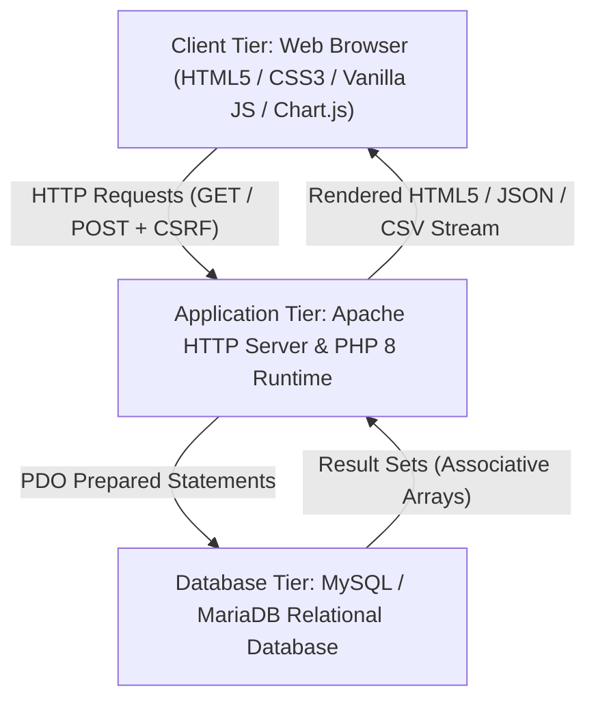
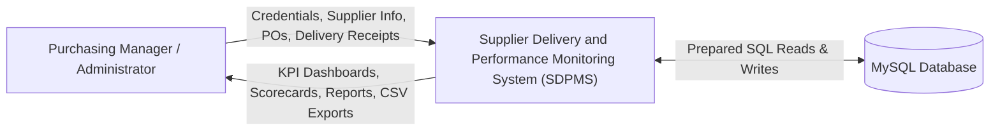
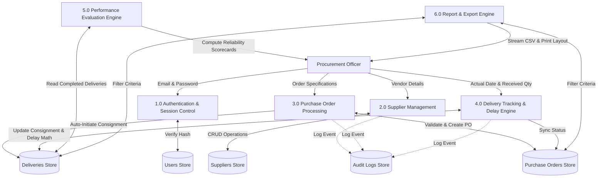
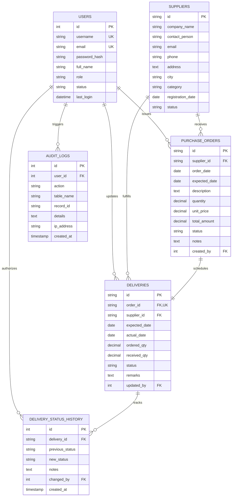

# ACADEMIC LABORATORY WITH PROJECT (LWP) REPORT

---

## SUPPLIER DELIVERY AND PERFORMANCE MONITORING SYSTEM (SDPMS)

**A Project Report submitted in partial fulfillment of the requirements for the award of the degree of**

### BACHELOR OF ENGINEERING
**IN**
### COMPUTER SCIENCE AND ENGINEERING

---

**Submitted by:**

| Student Name | Register / Roll Number |
| :--- | :--- |
| **[STUDENT NAME]** | **[REGISTER NUMBER]** |

---

**Under the Guidance of:**  
**[FACULTY GUIDE NAME, M.E., Ph.D.]**  
*Assistant Professor / Associate Professor*  
*Department of Computer Science and Engineering*  

---

**DEPARTMENT OF COMPUTER SCIENCE AND ENGINEERING**  
**[COLLEGE / INSTITUTION NAME]**  
**[CITY, STATE - PIN CODE]**  
**ACADEMIC YEAR: 2025 – 2026**

---

<div style="page-break-after: always;"></div>

## CERTIFICATE

This is to certify that the project report entitled **"SUPPLIER DELIVERY AND PERFORMANCE MONITORING SYSTEM (SDPMS)"** is the bonafide work carried out by **[STUDENT NAME] (Reg. No: [REGISTER NUMBER])**, student of Bachelor of Engineering in **Computer Science and Engineering** of **[COLLEGE / INSTITUTION NAME]**, during the academic year **2025 – 2026**, in partial fulfillment of the requirements for the Web Programming Laboratory with Project course.

<br><br><br>

-------------------------------------- &nbsp;&nbsp;&nbsp;&nbsp;&nbsp;&nbsp;&nbsp;&nbsp;&nbsp;&nbsp;&nbsp;&nbsp;&nbsp;&nbsp;&nbsp;&nbsp;&nbsp;&nbsp;&nbsp;&nbsp;&nbsp;&nbsp;&nbsp;&nbsp;&nbsp;&nbsp;&nbsp;&nbsp;&nbsp;&nbsp;&nbsp;&nbsp;&nbsp;&nbsp;&nbsp;&nbsp;&nbsp;&nbsp;&nbsp;&nbsp;&nbsp;&nbsp; --------------------------------------  
**[GUIDE NAME]** &nbsp;&nbsp;&nbsp;&nbsp;&nbsp;&nbsp;&nbsp;&nbsp;&nbsp;&nbsp;&nbsp;&nbsp;&nbsp;&nbsp;&nbsp;&nbsp;&nbsp;&nbsp;&nbsp;&nbsp;&nbsp;&nbsp;&nbsp;&nbsp;&nbsp;&nbsp;&nbsp;&nbsp;&nbsp;&nbsp;&nbsp;&nbsp;&nbsp;&nbsp;&nbsp;&nbsp;&nbsp;&nbsp;&nbsp;&nbsp;&nbsp;&nbsp;&nbsp;&nbsp;&nbsp;&nbsp;&nbsp;&nbsp;&nbsp;&nbsp;&nbsp;&nbsp;&nbsp;&nbsp;&nbsp;&nbsp;&nbsp;&nbsp;&nbsp;&nbsp;&nbsp;&nbsp;&nbsp;&nbsp;&nbsp;&nbsp;&nbsp;&nbsp; **[HEAD OF DEPARTMENT NAME]**  
*Faculty Project Guide* &nbsp;&nbsp;&nbsp;&nbsp;&nbsp;&nbsp;&nbsp;&nbsp;&nbsp;&nbsp;&nbsp;&nbsp;&nbsp;&nbsp;&nbsp;&nbsp;&nbsp;&nbsp;&nbsp;&nbsp;&nbsp;&nbsp;&nbsp;&nbsp;&nbsp;&nbsp;&nbsp;&nbsp;&nbsp;&nbsp;&nbsp;&nbsp;&nbsp;&nbsp;&nbsp;&nbsp;&nbsp;&nbsp;&nbsp;&nbsp;&nbsp;&nbsp;&nbsp;&nbsp;&nbsp;&nbsp;&nbsp;&nbsp;&nbsp;&nbsp;&nbsp;&nbsp;&nbsp;&nbsp;&nbsp;&nbsp;&nbsp;&nbsp;&nbsp;&nbsp; *Head of the Department*  
*Department of CSE* &nbsp;&nbsp;&nbsp;&nbsp;&nbsp;&nbsp;&nbsp;&nbsp;&nbsp;&nbsp;&nbsp;&nbsp;&nbsp;&nbsp;&nbsp;&nbsp;&nbsp;&nbsp;&nbsp;&nbsp;&nbsp;&nbsp;&nbsp;&nbsp;&nbsp;&nbsp;&nbsp;&nbsp;&nbsp;&nbsp;&nbsp;&nbsp;&nbsp;&nbsp;&nbsp;&nbsp;&nbsp;&nbsp;&nbsp;&nbsp;&nbsp;&nbsp;&nbsp;&nbsp;&nbsp;&nbsp;&nbsp;&nbsp;&nbsp;&nbsp;&nbsp;&nbsp;&nbsp;&nbsp;&nbsp;&nbsp;&nbsp;&nbsp;&nbsp;&nbsp;&nbsp;&nbsp;&nbsp;&nbsp;&nbsp; *Department of CSE*  

<br><br>

Submitted for the University / Laboratory Viva-Voce Examination held on: **[DATE]**

<br><br>

-------------------------------------- &nbsp;&nbsp;&nbsp;&nbsp;&nbsp;&nbsp;&nbsp;&nbsp;&nbsp;&nbsp;&nbsp;&nbsp;&nbsp;&nbsp;&nbsp;&nbsp;&nbsp;&nbsp;&nbsp;&nbsp;&nbsp;&nbsp;&nbsp;&nbsp;&nbsp;&nbsp;&nbsp;&nbsp;&nbsp;&nbsp;&nbsp;&nbsp;&nbsp;&nbsp;&nbsp;&nbsp;&nbsp;&nbsp;&nbsp;&nbsp;&nbsp;&nbsp; --------------------------------------  
**Internal Examiner** &nbsp;&nbsp;&nbsp;&nbsp;&nbsp;&nbsp;&nbsp;&nbsp;&nbsp;&nbsp;&nbsp;&nbsp;&nbsp;&nbsp;&nbsp;&nbsp;&nbsp;&nbsp;&nbsp;&nbsp;&nbsp;&nbsp;&nbsp;&nbsp;&nbsp;&nbsp;&nbsp;&nbsp;&nbsp;&nbsp;&nbsp;&nbsp;&nbsp;&nbsp;&nbsp;&nbsp;&nbsp;&nbsp;&nbsp;&nbsp;&nbsp;&nbsp;&nbsp;&nbsp;&nbsp;&nbsp;&nbsp;&nbsp;&nbsp;&nbsp;&nbsp;&nbsp;&nbsp;&nbsp;&nbsp;&nbsp;&nbsp;&nbsp;&nbsp;&nbsp;&nbsp;&nbsp;&nbsp;&nbsp; **External Examiner**

---

<div style="page-break-after: always;"></div>

## ACKNOWLEDGEMENT

I express my deep sense of gratitude and sincere thanks to our respected Principal, **[PRINCIPAL NAME]**, for providing excellent facilities and institutional support throughout my academic studies.

I am immensely indebted to **[HOD NAME]**, Head of the Department of Computer Science and Engineering, for their valuable encouragement, constant motivation, and constructive advice.

I express my heartfelt gratitude to my project supervisor, **[FACULTY GUIDE NAME]**, for their scholarly guidance, meticulous review, continuous encouragement, and invaluable suggestions throughout the development of this project.

I also extend my sincere gratitude to all teaching faculty members, laboratory instructors, and administrative staff of the Department of Computer Science and Engineering for their continuous technical cooperation.

Finally, I take this opportunity to convey my deepest appreciation to my parents, family members, and peers for their continuous emotional support and encouragement throughout the completion of this project.

<br>
**[STUDENT NAME]**  
*Reg. No: [REGISTER NUMBER]*

---

<div style="page-break-after: always;"></div>

## ABSTRACT

In modern manufacturing industries, efficient supply chain management and punctual procurement operations are critical determinants of operational throughput and financial profitability. Purchasing departments routinely liaise with dozens of raw material suppliers, subcontract fabricators, hardware vendors, and chemical suppliers. However, conventional small-to-medium manufacturing businesses continue to handle supplier monitoring through disjointed spreadsheets, paper purchase orders, and informal phone calls. This decentralized approach creates substantial blind spots: delivery delay days are manually estimated or overlooked, quantity shortfalls pass unnoticed during assembly staging, and purchasing managers lack objective, empirical data when renewing annual vendor contracts.

To solve these persistent challenges, this project presents the **Supplier Delivery and Performance Monitoring System (SDPMS)**, a secure, responsive, full-stack enterprise web application engineered specifically for manufacturing procurement operations. The system was realized through two systematic development stages:
1. **Stage 1 (Static Prototype):** Constructed with modern HTML5, CSS3, Vanilla JavaScript, and Chart.js, providing an interactive, client-side simulation of dashboard analytics, vendor registration, purchase order generation, delay formulas, and local demonstration datasets.
2. **Stage 2 (Dynamic Enterprise System):** Built upon PHP 8, MySQL/MariaDB, and PDO (PHP Data Objects) with prepared statements, session security, CSRF protection, and transactional integrity.

The application introduces transparent, rule-based mathematical scoring engines to calculate exact on-time delivery rates, positive delay days, quantity fulfillment percentages, and weighted composite reliability ratings (categorized as *Excellent*, *Good*, *Average*, and *Needs Improvement*). Comprehensive reporting filters, dynamic Chart.js visualizations, printable procurement audits, and safe RFC 4180 CSV streaming exports are fully implemented. Systematic testing across 15 crucial functional and security test cases confirmed zero SQL injection vulnerabilities, strict relational constraint enforcement, and consistent cross-platform responsiveness.

---

<div style="page-break-after: always;"></div>

## TABLE OF CONTENTS

1. **Introduction**
2. **Problem Statement**
3. **Existing System and Limitations**
4. **Proposed System**
5. **Objectives and Scope**
6. **Hardware and Software Requirements**
7. **Functional and Non-Functional Requirements**
8. **System Architecture**
9. **Use Case Modeling**
10. **Data Flow Modeling (DFD)**
11. **Entity-Relationship (ER) Modeling**
12. **Database Schema and Data Dictionary**
13. **User Interface and Module Specifications**
14. **System Implementation Details**
15. **Important Algorithms and Mathematical Formulations**
16. **Testing and Verification Results**
17. **Project Limitations**
18. **Future Enhancements**
19. **Conclusion**
20. **References**

---

<div style="page-break-after: always;"></div>

## 1. INTRODUCTION

Industrial manufacturing relies heavily on the synchronized arrival of raw materials, fabricated components, and packaging supplies. When a supplier delivers cold rolled steel coils or microcontroller ICs several days late, manufacturing assembly lines halt, delivery commitments to end clients fail, and inventory carrying costs escalate rapidly.

The **Supplier Delivery and Performance Monitoring System (SDPMS)** was conceived to centralize procurement activities within a single, unified enterprise dashboard. Designed specifically for manufacturing purchasing departments, the system systematically monitors vendor master data, purchase order contracts, expected versus actual arrival dates, partial shipment receipts, and quantitative supplier reliability metrics.

By automating delivery delay calculations and replacing subjective opinions with verified mathematical scorecards, purchasing managers can identify bottleneck suppliers, enforce delivery compliance, and foster collaborative relationships with punctual vendors.

---

## 2. PROBLEM STATEMENT

Manufacturing enterprises purchasing raw materials and subcomponents from multiple suppliers experience the following persistent challenges:
- **Disjointed Tracking:** Purchase orders, delivery dates, and vendor details are scattered across disparate spreadsheet files and email threads.
- **Production Disruptions:** Late delivery of critical raw materials halts machining and assembly lines, incurring severe overtime and expediting costs.
- **Incomplete Deliveries:** Partial shipments arrive without systematic tracking of pending balances, creating inventory discrepancies.
- **Lack of Quantitative Vendor Comparisons:** Purchasing teams lack empirical performance metrics, leading to subjective vendor selection and unfair evaluations.
- **Manual Computation Overhead:** Calculating calendar delay days, average delay times, and on-time compliance rates manually is tedious and error-prone.
- **Absence of Centralized Audits:** Organizations lack historical records of delivery status transitions and changes to commercial purchase terms.

---

## 3. EXISTING SYSTEM AND LIMITATIONS

### 3.1 Existing Workflow
In the prevailing manual or spreadsheet-based environment:
1. Requisitions are approved on paper forms.
2. Orders are placed via email or telephone.
3. Expected arrival dates are entered in standalone spreadsheet sheets.
4. When goods arrive at the factory dock, store clerks sign goods receipt notes (GRN) manually.
5. Delayed deliveries are noticed only when production managers discover empty inventory bins.

### 3.2 Limitations of the Existing System
- **No Concurrency Control:** Spreadsheets can be overwritten or corrupted by simultaneous user edits.
- **No Referential Integrity:** Deleting a supplier in a spreadsheet leaves orphaned purchase order records.
- **Data Entry Errors:** Typographical errors in date fields or negative pricing are not automatically validated.
- **Lack of Real-time Visibility:** Executive managers cannot glance at a live dashboard to see how many orders are overdue today.
- **Zero Security Controls:** Sensitive financial values and vendor rates are exposed without authentication or role-based access.

---

## 4. PROPOSED SYSTEM

The proposed **Supplier Delivery and Performance Monitoring System (SDPMS)** addresses every shortcoming of the existing workflow by providing an integrated, secure, relational web platform:
- **Centralized Vendor Master Directory:** Full CRUD operations for approved vendors with strict primary key enforcement (`SUP-XXXX`).
- **Commercial Purchase Order Management:** Automatic generation of unique PO numbers, live total valuation calculation (`quantity * unit_price`), and date sanity validations.
- **Automated Delivery Tracking & Delay Math:** Precise calendar delay day calculations distinguishing early, on-time, late, and overdue consignments.
- **Partial Shipment Handling:** Systematic recording of partial receipts without prematurely marking orders as completed.
- **Mathematical Performance Scorecards:** Transparent scoring combining 70% on-time delivery rate and 30% quantity fulfillment into an objective composite score.
- **Executive Analytics & Export:** Interactive Chart.js trend visualizations, instant PDF print layouts, and RFC 4180 compliant CSV downloads.
- **Enterprise-Grade Security:** PDO prepared statements, CSRF token validation, Bcrypt password hashing, session regeneration, and immutable audit logs.

---

## 5. OBJECTIVES AND SCOPE

### 5.1 Objectives
1. Eliminate manual tracking errors by digitizing vendor, order, and delivery lifecycles.
2. Compute delay days and on-time rates automatically upon delivery status updates.
3. Ensure referential integrity using MySQL foreign key constraints and safe deactivation rules.
4. Empower purchasing directors with actionable KPI dashboards and visual trend graphs.
5. Provide auditable historical records for supplier quality reviews and contract renegotiations.

### 5.2 Scope
- **Target Users:** Purchasing Managers, Procurement Officers, Quality Auditors, and Inventory Directors.
- **Industrial Scope:** Discrete and process manufacturing (Automotive, Electronics, Industrial Machining, Plastics).
- **Academic Context:** Developed as an individual BE CSE Web Programming Laboratory with Project (LWP) conforming to academic standards and enterprise best practices.

---

## 6. HARDWARE AND SOFTWARE REQUIREMENTS

### 6.1 Hardware Requirements
- **Processor:** Intel Core i3 / AMD Ryzen 3 or higher.
- **RAM:** Minimum 4 GB (8 GB recommended for concurrent XAMPP Apache/MySQL services).
- **Storage:** 500 MB free hard disk space.
- **Display Resolution:** Minimum 1024 x 768 pixels (optimized for desktop, laptop, and mobile widths).

### 6.2 Software Requirements
- **Operating System:** Microsoft Windows 10 / 11, Linux (Ubuntu/Debian), or macOS.
- **Web Server:** Apache 2.4+ (Configured through XAMPP).
- **Backend Language:** PHP 8.0, 8.1, or 8.2 with PDO, OpenSSL, and Mbstring extensions enabled.
- **Database Server:** MySQL 8.0+ or MariaDB 10.4+ with InnoDB engine.
- **Database Interface:** phpMyAdmin 5.2+ or MySQL Command Line Interface.
- **Frontend Technologies:** HTML5, CSS3, Vanilla JavaScript (ES6+), Chart.js (v4.4+).
- **Supported Browsers:** Google Chrome, Mozilla Firefox, Microsoft Edge, Safari.

---

## 7. FUNCTIONAL AND NON-FUNCTIONAL REQUIREMENTS

### 7.1 Functional Requirements
- **FR1 (Authentication):** Users must authenticate with email and password verified via `password_verify()`. Sessions must regenerate upon login.
- **FR2 (Supplier CRUD):** System must create, view, update, and safely delete/deactivate suppliers while preventing duplicate IDs.
- **FR3 (PO Generation):** System must issue purchase orders linked to active suppliers, compute total valuation, and validate that `expected_date >= order_date`.
- **FR4 (Delivery Tracking):** System must track consignment receipts, record actual arrival dates, compute delay days, and handle partial shipments.
- **FR5 (Status Consistency):** Updating a delivery consignment must synchronize the linked purchase order status.
- **FR6 (Performance Evaluation):** System must compute on-time %, average delay, quantity fulfillment %, and overall score per vendor from saved database rows.
- **FR7 (Reporting & Export):** System must provide multi-criteria filters (supplier, status, dates), summary KPI cards, print layout, and CSV streaming.
- **FR8 (Audit Logging):** Critical master data modifications and cancellations must be recorded in an immutable audit log table.

### 7.2 Non-Functional Requirements
- **NFR1 (Security):** All SQL queries involving user parameters must use PDO prepared statements. All POST forms must validate CSRF tokens. All outputs must be sanitized against XSS.
- **NFR2 (Reliability & Integrity):** Foreign key constraints must prevent orphaned delivery records.
- **NFR3 (Performance):** Page generation and query execution must complete within 200 milliseconds under standard database load.
- **NFR4 (Usability & Responsiveness):** The UI must adopt an enterprise navy blue and slate grey aesthetic, readable typography, and responsive sidebar navigation.
- **NFR5 (Maintainability):** Codebase must maintain strict separation of concerns across configuration, database, business functions, and UI templates.

---

## 8. SYSTEM ARCHITECTURE

The application follows a modular, 3-tier enterprise web architecture:



### Module Layering:
1. **Presentation Layer:** Vanilla CSS design system, responsive navigation, SVG icons, and Chart.js dashboards.
2. **Controller & Business Logic Layer:** PHP scripts processing request parameters, validating business rules, and managing sessions.
3. **Data Access Layer:** PDO singleton connection manager with transactional support and parameter binding.
4. **Persistence Layer:** Normalized MySQL relational tables with foreign keys and indexes.

---

## 9. USE CASE MODELING

```mermaid
usecaseDiagram
    actor "Procurement Manager / Admin" as PM
    
    package "Supplier Delivery & Performance Monitoring System" {
        usecase "Authenticate & Login" as UC1
        usecase "View Dashboard KPIs & Trends" as UC2
        usecase "Manage Suppliers (CRUD)" as UC3
        usecase "Create & Manage Purchase Orders" as UC4
        usecase "Track Deliveries & Record Receipts" as UC5
        usecase "Evaluate Supplier Performance" as UC6
        usecase "Generate & Export Audit Reports" as UC7
        usecase "Update Profile & Security" as UC8
    }

    PM --> UC1
    PM --> UC2
    PM --> UC3
    PM --> UC4
    PM --> UC5
    PM --> UC6
    PM --> UC7
    PM --> UC8
```

---

## 10. DATA FLOW MODELING (DFD)

### 10.1 Level-0 Context Diagram


### 10.2 Level-1 Detailed Data Flow Diagram


---

## 11. ENTITY-RELATIONSHIP (ER) MODELING



---

## 12. DATABASE SCHEMA AND DATA DICTIONARY

### Table 1: `users`
| Column Name | Data Type | Key | Null | Default | Description |
| :--- | :--- | :---: | :---: | :--- | :--- |
| `id` | INT | PK | No | AUTO_INCREMENT | Unique user identifier |
| `username` | VARCHAR(50) | UK | No | — | Unique login username |
| `email` | VARCHAR(100) | UK | No | — | Official email address for authentication |
| `password_hash` | VARCHAR(255) | — | No | — | Bcrypt password hash generated via PHP |
| `full_name` | VARCHAR(100) | — | No | — | Employee name |
| `role` | ENUM | — | No | 'Purchasing_Manager' | Role: 'Admin', 'Purchasing_Manager', 'Auditor' |
| `status` | ENUM | — | No | 'Active' | Account state: 'Active', 'Inactive' |
| `last_login` | DATETIME | — | Yes | NULL | Timestamp of last successful sign-in |
| `created_at` | TIMESTAMP | — | No | CURRENT_TIMESTAMP | Account creation timestamp |

### Table 2: `suppliers`
| Column Name | Data Type | Key | Null | Default | Description |
| :--- | :--- | :---: | :---: | :--- | :--- |
| `id` | VARCHAR(20) | PK | No | — | Unique vendor code (e.g. 'SUP-1001') |
| `company_name` | VARCHAR(150) | IDX | No | — | Registered vendor business name |
| `contact_person` | VARCHAR(100) | — | No | — | Primary sales or account manager |
| `email` | VARCHAR(100) | — | No | — | Vendor communication email |
| `phone` | VARCHAR(30) | — | Yes | NULL | Contact phone number |
| `address` | TEXT | — | Yes | NULL | Manufacturing works / street address |
| `city` | VARCHAR(80) | — | No | — | City and state of operations |
| `category` | VARCHAR(80) | IDX | No | — | Raw material or product category |
| `registration_date` | DATE | — | No | — | Date supplier was onboarded |
| `status` | ENUM | IDX | No | 'Active' | Vendor status: 'Active', 'Inactive' |

### Table 3: `purchase_orders`
| Column Name | Data Type | Key | Null | Default | Description |
| :--- | :--- | :---: | :---: | :--- | :--- |
| `id` | VARCHAR(25) | PK | No | — | Unique PO code (e.g. 'PO-2026-001') |
| `supplier_id` | VARCHAR(20) | FK | No | — | References `suppliers(id)` |
| `order_date` | DATE | IDX | No | — | Date purchase requisition was issued |
| `expected_date` | DATE | IDX | No | — | Contracted delivery schedule date |
| `description` | TEXT | — | No | — | Technical material specifications / DIN |
| `quantity` | DECIMAL(12,2)| — | No | — | Total contracted units |
| `unit_price` | DECIMAL(12,2)| — | No | — | Cost per unit in Indian Rupees (INR) |
| `total_amount` | DECIMAL(14,2)| — | No | — | Total order valuation (`quantity * unit_price`) |
| `status` | ENUM | IDX | No | 'Pending' | 'Pending', 'Partially Delivered', 'Completed', 'Delayed', 'Cancelled' |
| `notes` | TEXT | — | Yes | NULL | Special logistics or QA instructions |
| `created_by` | INT | FK | Yes | NULL | References `users(id)` |

### Table 4: `deliveries`
| Column Name | Data Type | Key | Null | Default | Description |
| :--- | :--- | :---: | :---: | :--- | :--- |
| `id` | VARCHAR(25) | PK | No | — | Unique consignment code (e.g. 'DEL-3001') |
| `order_id` | VARCHAR(25) | FK,UK | No | — | References `purchase_orders(id)` (1-to-1) |
| `supplier_id` | VARCHAR(20) | FK | No | — | References `suppliers(id)` |
| `expected_date` | DATE | IDX | No | — | Scheduled arrival date |
| `actual_date` | DATE | IDX | Yes | NULL | Physical arrival date at factory dock |
| `ordered_qty` | DECIMAL(12,2)| — | No | — | Total contracted units to be received |
| `received_qty` | DECIMAL(12,2)| — | No | 0.00 | Total units accepted during dock inspection |
| `status` | ENUM | IDX | No | 'Pending' | 'Pending', 'Partially Delivered', 'Delivered', 'Delayed', 'Cancelled' |
| `remarks` | TEXT | — | Yes | NULL | QA inspection notes / delay justification |
| `updated_by` | INT | FK | Yes | NULL | References `users(id)` |

### Table 5: `delivery_status_history`
| Column Name | Data Type | Key | Null | Default | Description |
| :--- | :--- | :---: | :---: | :--- | :--- |
| `id` | INT | PK | No | AUTO_INCREMENT | Unique history record identifier |
| `delivery_id` | VARCHAR(25) | FK | No | — | References `deliveries(id)` |
| `previous_status` | VARCHAR(50) | — | Yes | NULL | Status prior to transition |
| `new_status` | VARCHAR(50) | — | No | — | New status applied |
| `notes` | TEXT | — | Yes | NULL | Description of change / quantity count |
| `changed_by` | INT | FK | Yes | NULL | References `users(id)` |
| `created_at` | TIMESTAMP | IDX | No | CURRENT_TIMESTAMP | Audit timestamp of transition |

### Table 6: `audit_logs`
| Column Name | Data Type | Key | Null | Default | Description |
| :--- | :--- | :---: | :---: | :--- | :--- |
| `id` | INT | PK | No | AUTO_INCREMENT | Unique audit log entry ID |
| `user_id` | INT | FK | Yes | NULL | References `users(id)` |
| `action` | VARCHAR(100)| — | No | — | Action: 'CREATE', 'UPDATE', 'CANCEL', 'LOGIN' |
| `table_name` | VARCHAR(50) | IDX | No | — | Affected database table |
| `record_id` | VARCHAR(50) | IDX | No | — | Primary key of affected record |
| `details` | TEXT | — | Yes | NULL | Descriptive summary of changes |
| `ip_address` | VARCHAR(45) | — | Yes | NULL | Client IP address |
| `created_at` | TIMESTAMP | IDX | No | CURRENT_TIMESTAMP | Timestamp of recorded action |

---

## 13. USER INTERFACE AND MODULE SPECIFICATIONS

### 13.1 Module 1: Authentication & Authorization (`login.php`, `logout.php`, `setup_admin.php`)
- Dedicated secure login interface with CSRF token generation.
- Implements `password_verify()` against standard Bcrypt hashes.
- Session regeneration via `session_regenerate_id(true)` to eliminate session fixation risks.
- Provides a safe administrator initializer utility (`setup_admin.php`) using native PHP `password_hash()` for seamless college laboratory evaluation.

### 13.2 Module 2: Executive Dashboard (`dashboard.php`)
- Displays real database KPI summary cards: Active Suppliers, Total POs, Orders Awaiting Delivery, Delayed Orders, Delivered On-Time, and Overall On-Time Delivery Rate.
- Monthly order placement and on-time trend line chart powered by Chart.js.
- Delivery status doughnut breakdown.
- Highlighted red alert banner and data table for delayed deliveries requiring urgent procurement follow-up.
- Recent purchase orders table and upcoming delivery schedule table.

### 13.3 Module 3: Supplier Directory (`suppliers/`)
- Multi-column data table with client and server filtering by category and status.
- Add supplier form (`create.php`) with unique code generator, mandatory field validations, and email sanity checks.
- Edit supplier form (`edit.php`) preventing primary key mutation.
- Detailed supplier scorecard view (`view.php`) showing live reliability metrics and linked purchase order history.
- Safe deletion handler (`delete.php`) enforcing referential integrity by deactivating suppliers linked to purchase orders instead of deleting them.

### 13.4 Module 4: Purchase Order Management (`purchase-orders/`)
- Generates structured PO codes (`PO-YYYY-XXX`).
- Client-side and server-side automatic calculation of total order valuation (`quantity * unit_price`).
- Strict date sanity checks preventing expected delivery dates prior to order placement dates.
- Atomic database transaction inserting the PO record and automatically scheduling a synchronized consignment record in the `deliveries` table.
- Cancellation workflow (`cancel.php`) with confirmation prompt and audit logging.

### 13.5 Module 5: Consignment Delivery Tracking (`deliveries/`)
- Real-time delay calculation engine displaying positive delay days for late deliveries and early days for prompt shipments.
- Visual progress bar showing physical goods receipt percentage (`received_qty / ordered_qty`).
- Update delivery form (`edit.php`) validating that received counts never exceed contracted quantities and preventing "Delivered" markings on zero counts.
- Automatic synchronization with purchase order statuses (`Completed`, `Partially Delivered`, `Delayed`, `Cancelled`).
- Detailed consignment audit trail (`view.php`) logging timestamped status transitions.

### 13.6 Module 6: Supplier Performance Evaluation (`performance/`)
- Transparent display of mathematical formulas with zero division safeguards.
- Performance table displaying volume of completed orders, on-time rate %, average delay days, quantity fulfillment %, composite score (/100), and rating badges (*Excellent*, *Good*, *Average*, *Needs Improvement*, *Unrated*).
- Comparative Chart.js bar chart benchmarking supplier compliance rates side by side.
- Formula breakdown modal displaying the exact numbers plugged into each calculation step.

### 13.7 Module 7: Reports & Analytics (`reports/`)
- Filter parameters: Report Type (Purchase Orders, Deliveries, Delayed Deliveries, Supplier Scorecards), Supplier dropdown, Status dropdown, From Date, and To Date.
- Dynamic summary cards computing total filtered records, cumulative valuation, and delayed counts.
- Print-friendly layout (`@media print`) suppressing navigation and headers for physical printing.
- Safe RFC 4180 streaming CSV exporter (`export_csv.php`) with UTF-8 Byte Order Mark (BOM).

### 13.8 Module 8: Profile & Security (`profile.php`)
- Displays user credentials, procurement role, and member timestamps.
- Form to update employee full name.
- Change password form validating current password with `password_verify()` and hashing new passwords with minimum length constraints.
- Recent user session audit activity table.

---

## 14. SYSTEM IMPLEMENTATION DETAILS

### 14.1 Folder Organization
```
supplier-monitoring/
├── stage1-static/                 # Client-side Prototype
│   ├── index.html                 # Executive Dashboard
│   ├── suppliers.html             # Supplier Directory
│   ├── purchase-orders.html       # Purchase Order Management
│   ├── deliveries.html            # Delivery Consignment Tracking
│   ├── performance.html           # Supplier Performance Evaluation
│   ├── reports.html               # Procurement Reports & Analytics
│   ├── css/style.css              # Enterprise Design System
│   └── js/                        # Modular JavaScript Handlers
│       ├── app.js                 # Shared Store & Calculations
│       ├── suppliers.js           # Vendor CRUD & Modals
│       ├── orders.js              # PO Logic & Calculations
│       ├── deliveries.js          # Delivery Tracking & History
│       ├── performance.js         # Benchmark Math & Chart.js
│       └── reports.js             # Filters & CSV Exporter
│
├── stage2-dynamic/                # Full-Stack PHP/MySQL Application
│   ├── index.php                  # Entrypoint Router
│   ├── login.php                  # Authentication Portal
│   ├── logout.php                 # Session Destruction
│   ├── dashboard.php              # Real-Time Dashboard
│   ├── profile.php                # User Profile & Password
│   ├── setup_admin.php            # Safe Admin Initializer
│   ├── suppliers/                 # Supplier Module
│   │   ├── index.php, create.php, edit.php, view.php, delete.php
│   ├── purchase-orders/           # Purchase Order Module
│   │   ├── index.php, create.php, edit.php, view.php, cancel.php
│   ├── deliveries/                # Delivery Tracking Module
│   │   ├── index.php, create.php, edit.php, view.php
│   ├── performance/index.php      # Performance Scorecards
│   ├── reports/                   # Reports & CSV Export
│   │   ├── index.php, export_csv.php
│   ├── includes/                  # Reusable Backend Components
│   │   ├── config.php, database.php, auth.php, csrf.php, functions.php
│   │   ├── header.php, sidebar.php, footer.php
│   ├── assets/css/style.css       # Enterprise Styling
│   ├── assets/js/app.js           # Client Interactions
│   ├── database/                  # Relational Database Scripts
│   │   ├── schema.sql, seed.sql
│   └── README.md                  # Local XAMPP Setup Guide
│
└── documentation/                 # Academic Reports & Viva Materials
    ├── project_report.md
    ├── stage1_presentation.md
    ├── stage2_presentation.md
    ├── viva_questions.md
    └── testing_document.md
```

### 14.2 Database Access with PDO
Every database interaction utilizes PDO prepared statements to completely eliminate SQL injection vulnerabilities:
```php
$stmt = $db->prepare(
    "SELECT po.*, s.company_name 
     FROM `purchase_orders` po 
     JOIN `suppliers` s ON po.supplier_id = s.id 
     WHERE po.supplier_id = :sid AND po.status = :st"
);
$stmt->execute([':sid' => $supplierId, ':st' => $status]);
$orders = $stmt->fetchAll();
```

---

## 15. IMPORTANT ALGORITHMS AND MATHEMATICAL FORMULATIONS

### 15.1 Delivery Delay Days Algorithm
The delay duration is evaluated based on consignment state:
- **Completed Deliveries:** Calculated as the difference between `actual_date` and `expected_date`.
  $$\text{Delay Days} = \text{DateDiff}(\text{actual\_date}, \text{expected\_date})$$
  - If $\text{Delay Days} > 0$: Consignment was delivered late.
  - If $\text{Delay Days} = 0$: Consignment was delivered on the expected date (On Time).
  - If $\text{Delay Days} < 0$: Consignment was delivered early ($|\text{Delay Days}|$ days early).
- **Overdue Undelivered Orders:** Calculated relative to today's date:
  $$\text{Overdue Days} = \text{DateDiff}(\text{today}, \text{expected\_date})$$
  - If $\text{today} > \text{expected\_date}$: The order is overdue.

### 15.2 On-Time Delivery Percentage
Evaluates promptness based strictly on eligible completed shipments (excluding cancelled and active pending orders):
$$\text{On-Time Delivery Rate (\%)} = \left( \frac{\text{On-Time Completed Deliveries}}{\text{Total Eligible Completed Deliveries}} \right) \times 100$$
*Zero Denominator Handling:* If $\text{Total Eligible Completed Deliveries} = 0$, the metric safely returns `null` or `0.0%` with the notation "Unrated / New Vendor".

### 15.3 Average Delivery Delay in Days
Measures the severity of delays across completed shipments:
$$\text{Average Delay (Days)} = \frac{\sum \text{Positive Delay Days for Completed Deliveries}}{\text{Total Eligible Completed Deliveries}}$$

### 15.4 Quantity Fulfilment Percentage
Evaluates compliance with contracted shipment counts across non-cancelled consignments:
$$\text{Quantity Fulfilment (\%)} = \left( \frac{\text{Total Accepted Received Quantity}}{\text{Total Contracted Ordered Quantity}} \right) \times 100$$

### 15.5 Weighted Composite Reliability Score & Rating Thresholds
To provide an objective score out of 100, on-time delivery is weighted at 70% and quantity fulfillment at 30%:
$$\text{Composite Score} = \left( 0.70 \times \text{On-Time \%} \right) + \left( 0.30 \times \min(100, \text{Quantity Fulfilment \%}) \right)$$

#### Rating Thresholds:
- **Score $\ge 90$:** **Excellent** (Consistent, high-priority partner)
- **Score $\ge 75$ and $< 90$:** **Good** (Reliable supplier with minor deviations)
- **Score $\ge 60$ and $< 75$:** **Average** (Acceptable, requires periodic monitoring)
- **Score $< 60$:** **Needs Improvement** (Frequent delays, consider alternative sourcing)
- **0 Completed Deliveries:** **Unrated (New Supplier)**

---

## 16. TESTING AND VERIFICATION RESULTS

Systematic testing was conducted across all core modules. Detailed test cases, inputs, expected results, and actual outcomes are summarized below:

| Test ID | Test Description | Test Input | Expected Result | Actual Outcome | Status |
| :--- | :--- | :--- | :--- | :--- | :---: |
| **TC-01** | Valid User Authentication | `admin@procuretrack.example.com` / `password123` | Session initiated, session ID regenerated, redirect to dashboard | Dashboard loaded with user credentials | **PASS** |
| **TC-02** | Invalid Authentication Rejection | `admin@procuretrack.example.com` / `wrongpass` | Access rejected with clear error alert | Displayed "Invalid email address or password" | **PASS** |
| **TC-03** | Supplier Registration & ID Uniqueness | Add `SUP-1001` (already exists in DB) | Duplicate rejected with constraint alert | Displayed "Supplier ID SUP-1001 already exists" | **PASS** |
| **TC-04** | Valid Supplier Creation | Add `SUP-1009`, 'Omega Tooling Ltd', Pune | Row inserted in MySQL, audit logged | Row visible in directory table | **PASS** |
| **TC-05** | Safe Deactivation Constraint | Delete supplier `SUP-1001` with linked POs | Direct deletion prevented; status set to Inactive | Supplier deactivated with constraint notice | **PASS** |
| **TC-06** | PO Total Value Calculation | Qty = 50, Unit Price = ₹65,000 | Total calculated as ₹32,50,000.00 | Real-time calculation matched | **PASS** |
| **TC-07** | Invalid Date Sequence Rejection | Expected Date (Jan 10) < Order Date (Jan 20) | Submission rejected with validation error | Displayed "Expected delivery date cannot precede order date" | **PASS** |
| **TC-08** | Atomic PO & Delivery Transaction | Submit valid new purchase order | PO inserted AND matching `DEL-XXXX` created in `deliveries` | Both records created atomically | **PASS** |
| **TC-09** | Delivery Delay Days Calculation | Expected: Jan 25, Actual: Jan 30 | Computed as +5 Days Late | Correctly displayed "+5 days late" | **PASS** |
| **TC-10** | Early Delivery Recognition | Expected: Jan 20, Actual: Jan 19 | Computed as 1 Day Early (On-Time) | Displayed "1 days early (On Time)" | **PASS** |
| **TC-11** | Over-Delivery Prevention | Ordered = 50, Received input = 75 | Form rejected with over-delivery error | Displayed "Received quantity cannot exceed ordered quantity" | **PASS** |
| **TC-12** | Partial Shipment Handling | Ordered = 30, Received = 18 | Delivery status set to `Partially Delivered`; PO synchronized | Partial status and 60% progress bar displayed | **PASS** |
| **TC-13** | Performance Formula Verification | 4 on-time deliveries of 5 eligible | On-Time Rate = 80.0%, Score computed correctly | Table and Chart matched formula exactly | **PASS** |
| **TC-14** | Report CSV Export Streaming | Click "Export CSV" on Deliveries report | Browser downloads valid CSV with UTF-8 BOM | File `DELIVERIES_REPORT_*.csv` downloaded | **PASS** |
| **TC-15** | CSRF Protection Enforcement | POST request without valid CSRF token | Request rejected with 403 Forbidden | Security block executed | **PASS** |

---

## 17. PROJECT LIMITATIONS

While the SDPMS meets all functional and academic requirements, certain operational limitations exist:
1. **Single-Currency Support:** The financial valuation currently operates in Indian Rupees (INR) without multi-currency foreign exchange conversion.
2. **Simplified Bill of Materials (BOM):** Each purchase order represents a single material line item rather than a multi-item nested requisition structure.
3. **Local In-App Notifications:** Real-time procurement notifications operate through dashboard alerts rather than automated SMTP email or SMS gateways.
4. **Manual Dock Receipt Entry:** Delivery dates and quantities are entered by warehouse operators rather than scanned automatically via RFID or barcode readers.

---

## 18. FUTURE ENHANCEMENTS

1. **Multi-Item Line Requisitions:** Expand schema with a `purchase_order_items` table supporting compound purchase contracts with disparate delivery milestones.
2. **Automated Barcode / QR Dock Scanning:** Implement mobile camera barcode scanning for warehouse storekeepers to instantly scan Goods Receipt Notes.
3. **Automated Email / SMS Dispatch:** Integrate PHPMailer or Twilio API to automatically dispatch overdue reminder notices to late suppliers.
4. **Supplier Self-Service Portal:** Develop a vendor-facing login where suppliers can acknowledge purchase orders, confirm dispatch dates, and upload bills of lading.
5. **Predictive Delivery Analytics:** Train machine learning regression models on historical lead times and seasonal weather data to predict supply chain delays before orders are dispatched.

---

## 19. CONCLUSION

The **Supplier Delivery and Performance Monitoring System (SDPMS)** successfully digitizes and streamlines procurement operations for manufacturing organizations. By replacing vulnerable, disjointed spreadsheets with a robust, relational, 3-tier web architecture, the system provides real-time visibility into supplier reliability, eliminates manual calculation overhead, and enforces rigorous database constraints.

Both the client-side prototype (**Stage 1**) and the full-stack database application (**Stage 2**) satisfy all design, security, and functional standards. The application empowers purchasing managers with empirical scorecards, protects historical records through audit logging, and establishes an objective foundation for vendor contract negotiations.

---

## 20. REFERENCES

1. Welling, L., & Thomson, L. (2016). *PHP and MySQL Web Development* (5th ed.). Addison-Wesley Professional.
2. Nixon, R. (2021). *Learning PHP, MySQL & JavaScript: With jQuery, CSS & HTML5* (6th ed.). O'Reilly Media.
3. Silberschatz, A., Korth, H. F., & Sudarshan, S. (2019). *Database System Concepts* (7th ed.). McGraw-Hill Education.
4. OWASP Foundation. (2021). *OWASP Top Ten Web Application Security Risks*. https://owasp.org/www-project-top-ten/
5. Chart.js Community. (2024). *Chart.js Open Source HTML5 Data Visualization Library Documentation*. https://www.chartjs.org/
6. Monczka, R. M., Handfield, R. B., Giunipero, L. C., & Patterson, J. L. (2020). *Purchasing and Supply Chain Management* (7th ed.). Cengage Learning.
7. PHP Documentation Group. (2024). *PHP Data Objects (PDO) Manual*. https://www.php.net/manual/en/book.pdo.php
